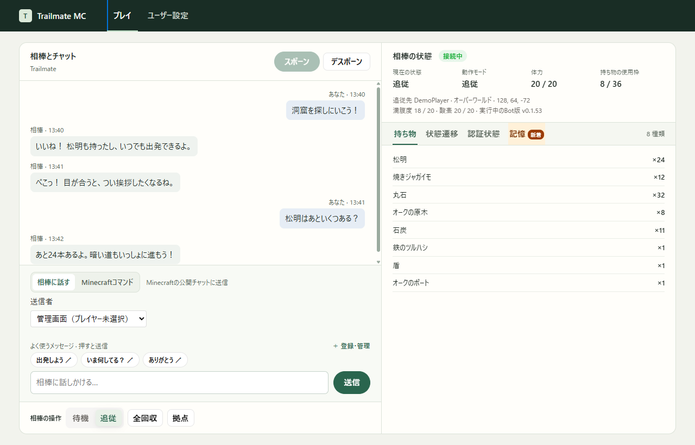
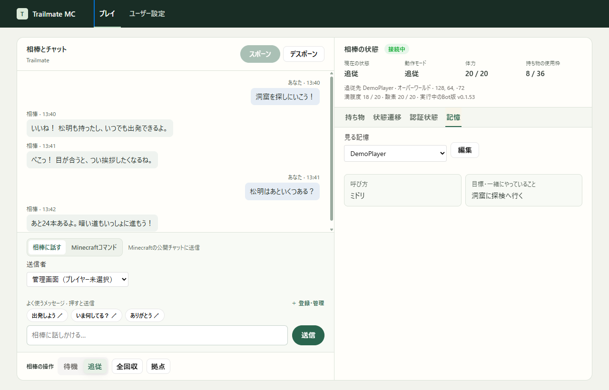

# Trailmate MC

**いつもの Minecraft ワールドに、冒険の相棒を。**

Trailmate MC は Minecraft Java Edition のサーバーにもう一人のプレイヤーとして参加するボットです。探検についてきて、暗い場所に松明を置いたり、近くの敵に応戦したりします。Claude API を設定すると、周囲の変化に合わせて声をかけ、チャットにも返事をします。

[最新版をダウンロード](https://github.com/koupent/trailmate-mc/releases/latest) · [はじめ方](#はじめ方) · [詳細ガイド](docs/guide.md)

*管理画面「プレイ」。公開用のサンプルデータで撮影。*

## 相棒とできること

| 場面 | 相棒の動き |
| --- | --- |
| **一緒に探検する** | 地上や水中で追従し、暗い道に松明を置き、空腹になると手持ちの食料を食べます。 |
| **危険に遭遇する** | 近くの敵に応戦し、水中では酸素が少なくなると呼吸できる場所へ戻ります。 |
| **声をかける** | 管理画面からメンションなしで話せます。目が合ったときや周りで変化があったときは、相棒から話すこともあります。 |
| **また一緒に遊ぶ** | 呼び名や一緒にあった出来事をプレイヤーごとの短いメモに保存し、会話に使います。右側の「記憶」で確認・編集できます。 |

管理画面では、待機・追従の切り替えや持ち物の確認もできます。よく使うメッセージや Minecraft のスラッシュコマンドはショートカットに登録できます。

記憶タブのスクリーンショット

## はじめ方

用意するものは **Docker Desktop**（Windows）と、相棒を参加させたい **Minecraft Java Edition のマルチプレイサーバー**です。オンライン認証が有効なサーバーでは、相棒用の Minecraft Java Edition アカウントを用意します。

1. [最新リリース](https://github.com/koupent/trailmate-mc/releases/latest)から Windows ZIP をダウンロードして展開します。
2. Docker Desktop の起動後、展開したフォルダーで `start.bat` を実行します。
3. [管理画面](http://127.0.0.1:8787)を開き、初回セットアップでサーバーアドレスを保存します。必要に応じて相棒用の Microsoft アカウントを登録します。
4. 「プレイ」で **スポーン** を押すと、相棒がワールドに参加します。遊び終わったら **デスポーン** で切断できます。

[macOS / Linux の手順](docs/guide.md#macos--linuxでのセットアップ) · [Microsoft アカウントの登録](docs/guide.md#microsoftアカウントの登録) · [接続で困ったとき](docs/guide.md#うまく動かないとき)

## Claude を使う（任意）

`start.bat` と同じフォルダーにある `.env` に `ANTHROPIC_API_KEY` を設定すると、返答や声かけを Claude が生成します。API を使えないときは、用意されている返答に切り替わります。設定の反映方法や予算の調整は[会話の設定](docs/guide.md#claude-で雑談対話する)を参照してください。

管理画面から送ったメッセージは Minecraft の**公開チャット**にも表示されます。Claude を利用すると、返答に必要なメッセージやワールドの状態などが Anthropic に送信されます。

## 更新する

管理画面の **ユーザー設定 → アップデート → 更新を確認 → 更新する**。更新後、相棒は「プレイ」からスポーンできます。[旧版からの更新と復旧手順](docs/guide.md#更新github-release)

## さらに詳しく

- [操作とチャットコマンド](docs/commands.md)
- [詳細ガイド（設定・会話・戦闘・開発）](docs/guide.md)
- [水中追従の検証](docs/water-regression.md)
- [不具合や改善案を送る](https://github.com/koupent/trailmate-mc/issues)

[MIT License](LICENSE) · [Mindcraft 由来部分のクレジット](NOTICE)
